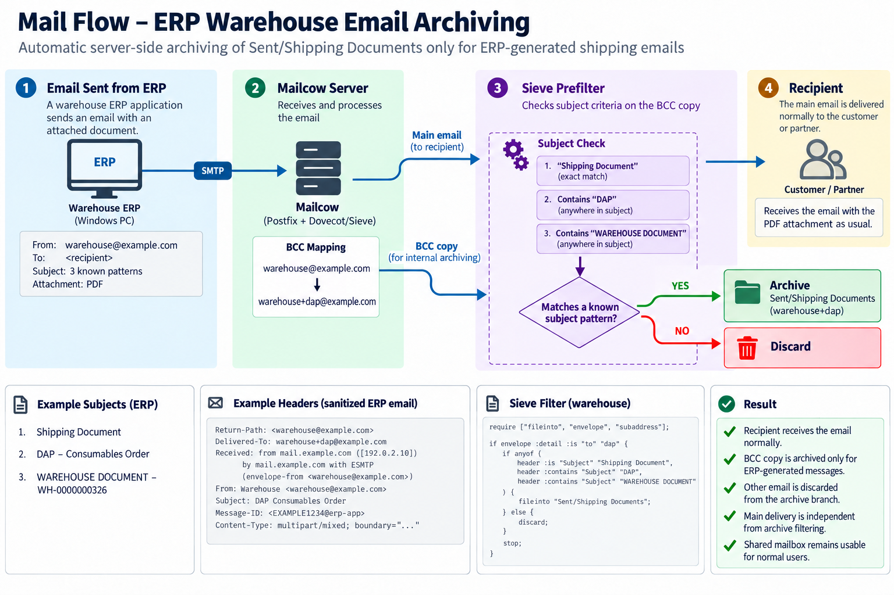

# Selective Sent-Mail Archiving for ERP Applications with Mailcow

## Overview

This project documents a server-side email archiving solution implemented in a production Mailcow environment to address missing Sent-folder copies of emails generated by ERP and HRM applications.

Although application-generated emails were successfully delivered to recipients via SMTP, no copies were stored in the sender's Sent folder in Outlook or SOGo.

The solution uses Mailcow's existing mail-routing and filtering capabilities to selectively archive application-generated messages without modifying the ERP applications or interfering with normal Outlook email workflows.

## Technologies

- Mailcow
- Postfix (SMTP)
- Dovecot / Sieve
- SOGo Webmail
- Microsoft Outlook
- Sender BCC Maps
- Plus Addressing
- SMTP / IMAP
- Email Header Analysis

## Problem

The ERP and HRM applications successfully submitted emails through the corporate SMTP server. However, these messages were missing from the sender's Sent folder.

Investigation identified the underlying issue:

**Successful SMTP delivery does not automatically create a copy in the sender's Sent folder.**

Unlike standard email clients, the applications did not perform the additional IMAP operation required to store a Sent copy.

The objective was to implement selective, server-side archiving while ensuring that normal Outlook emails remained unaffected.

## Solution Architecture

The implementation combines three Mailcow capabilities:

1. **Sender BCC Maps** — Generate additional server-side copies of outgoing messages.
2. **Plus Addressing** — Route archive copies through tagged mailbox addresses without creating separate mailboxes.
3. **Dovecot Sieve Prefilters** — Identify application-generated messages and store matching copies in dedicated folders.

The original messages continue to their intended recipients, independently of the selective archive workflow.


### Warehouse Email Archiving Flow

The following diagram illustrates the ERP warehouse email archiving workflow, including SMTP delivery, Sender BCC mapping, plus addressing, and selective Sieve filtering.



*Sanitized architecture diagram using illustrative email addresses, message headers, and subject patterns.*
  

### Email Processing Flow

```text
ERP / HRM Application
        |
        | SMTP
        v
Mailcow / Postfix
        |
        +----------------------> Original Recipient
        |
        +--> Sender BCC
                  |
                  v
          Tagged Mail Address
                  |
                  v
          Dovecot Sieve Filter
                  |
           Application Match?
              /        \
            YES         NO
             |           |
             v           v
       Sent Subfolder   Discard
                       BCC Copy
```

## Implementation Highlights

Two separate business workflows were configured:

**1. ERP Warehouse Email Archiving**

- Implemented selective archiving for shipping and warehouse documentation.
- Applied subject-based filtering using known application-generated email patterns.
- Stored matching copies in a dedicated Sent subfolder.

**2. HRM Email Archiving**

- Identified distinct Message-ID patterns between HRM-generated and standard Outlook emails.
- Configured selective filtering to distinguish application messages from ordinary email.
- Stored matching HRM messages in a separate Sent subfolder.

Both workflows were configured through the Mailcow administrative interface without requiring direct Linux server access.

## Validation & Results

The solution was validated using both application-generated emails and normal Outlook messages.

- Successful SMTP delivery confirmed.
- Application-generated messages archived in their designated folders.
- Normal Outlook messages remained in the standard Sent folder.
- Additional nonmatching BCC copies were discarded.
- Original email delivery remained unaffected during successful validation tests.

## Operational Considerations

The archiving rules depend on identifiable message characteristics.

The HRM workflow uses a Message-ID pattern, while the warehouse workflow uses known subject formats. Changes to these characteristics may require updates to the filtering rules.

These limitations are documented to support future troubleshooting and maintenance.

## Technical Documentation

Detailed implementation steps, configuration examples, validation procedures, and troubleshooting guidance:

- [Implementation Guide](docs/implementation.md)
- [Troubleshooting Guide](docs/troubleshooting.md)
- [HRM Sieve Filter Example](examples/hrm-archive.sieve)
- [Warehouse Sieve Filter Example](examples/warehouse-archive.sieve)

## Security & Confidentiality

This repository contains sanitized technical documentation and configuration examples.

Production email addresses, domains, workstation identifiers, message headers, credentials, and organization-specific information have been removed or replaced with illustrative values.
